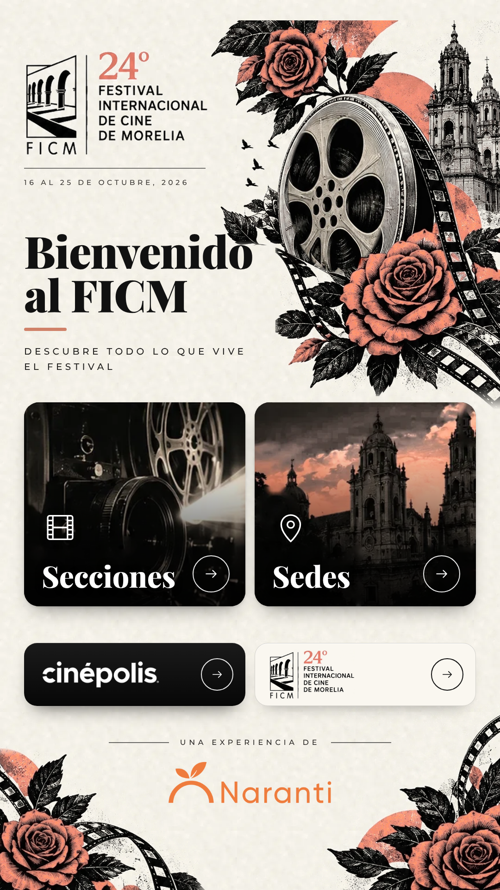

# ORION · FICM 2026

Interfaz de kiosco vertical de **Naranti SmartCity** para el **24.º Festival Internacional de Cine de Morelia** (16 al 25 de octubre de 2026).

Aplicación web **independiente**: React 18 + TypeScript + Vite + Motion. No se conecta a SmartCity, Firebase, el centro de control ni ningún servicio externo. No está publicada ni desplegada. La publicación, la URL, el hosting y la integración quedan a cargo del equipo de Naranti.



---

## 1. Requisitos

- **Node.js 20.19 o superior** (probado con Node 22) y npm.
- Un navegador moderno (Chrome / Chromium recomendado, como en el kiosco).

## 2. Instalar dependencias

```bash
cd ORION-FICM-2026
npm install
```

## 3. Ejecutar en local

```bash
npm run dev
```

Abrir **http://localhost:5173/**.

Para ver el lienzo exacto del kiosco, en Chrome abrir las herramientas de desarrollo → *Toggle device toolbar* → tamaño **1080 × 1920**. También puede usarse el panel de simulación:

```
http://localhost:5173/?debug=1
```

El botón **«Simulación»** (abajo a la izquierda) permite:

| Opción | Qué hace |
|---|---|
| Sin conexión | Muestra el aviso de red y el comportamiento sin internet |
| Fuera de fechas | Muestra la pantalla que aparecería fuera del 16–25 de octubre |
| Experiencia desactivada | Muestra la pantalla de "no disponible" |
| Mostrar zonas táctiles | Marca todas las zonas táctiles |
| Inactividad en 5 s | Acelera el aviso "¿Sigues ahí?" y el regreso al inicio |
| Simular error | Fuerza un error para ver la pantalla de recuperación automática |
| Modo de apertura | `preview` / `qr` / `iframe` (iframe carga sitios reales: solo para pruebas autorizadas) |
| Pantalla | Simula 1080×1920, 2160×3840 (4K), 1080×1600, 768×1366, 1200×1920 |
| Estado | Muestra `window.ORION.status()` |

### Parámetros de URL útiles

| Parámetro | Ejemplo | Efecto |
|---|---|---|
| `debug` | `?debug=1` o `#debug` | Panel de simulación |
| `idle` | `?idle=30` | Segundos de inactividad antes del aviso |
| `warning` | `?warning=5` | Segundos de cuenta atrás del aviso |
| `w`, `h` | `?w=1080&h=1920` | Lienzo de diseño (por defecto 1080 × 1920) |
| `mode` | `?mode=qr` | Modo de apertura de destinos |
| `lowpower` | `?lowpower=1` | Sin desenfoques ni animaciones pesadas |
| `guards` | `?guards=0` | Desactiva las protecciones de kiosco (útil al depurar) |

## 4. Compilar la versión de producción

```bash
npm run build
```

Ejecuta la comprobación de tipos y genera la carpeta **`dist/`**:

```
dist/
├── index.html            ← punto de entrada
├── orion.config.json     ← CONFIGURACIÓN EDITABLE (enlaces, inactividad, fechas…)
└── assets/               ← JS, CSS, fuentes e imágenes con hash (caché larga)
```

`dist/` es un **sitio estático**. Usa rutas relativas, así que funciona en la raíz de un dominio o en cualquier subruta, sin reglas de reescritura.

Para revisar la compilación en local:

```bash
npm run preview          # http://localhost:4173/
```

Más detalles para publicar (Netlify, Vercel, servidor propio): **[docs/PUBLICACION.md](docs/PUBLICACION.md)**. Esta entrega no publica nada.

## 5. Configurar enlaces y opciones

Todo se edita en **`public/orion.config.json`**. Tras compilar es **`dist/orion.config.json`** y puede cambiarse en el servidor **sin recompilar**:

```json
"links": {
  "sedes": null,
  "secciones": null,
  "cinepolis": "https://cinepolis.com/mx",
  "ficm": "https://moreliafilmfest.com/noticias"
}
```

- `null` = enlace pendiente: el botón funciona y muestra "Enlace oficial pendiente de verificar".
- Solo se admiten URLs `https://` o `http://`. Un valor inválido se ignora y nunca deja el kiosco en blanco.
- **No se inventó ninguna URL.** Las dos configuradas son las que indicó Naranti.

Otras opciones del mismo archivo:

| Clave | Por defecto | Descripción |
|---|---|---|
| `navigation.mode` | `"iframe"` | `iframe`: abre el sitio dentro del kiosco, con barra fija (Regresar · marca · QR · Inicio) y la firma Naranti; si no carga, pasa al QR. `qr`: muestra un código QR para el teléfono. `preview`: demostración interna, sin cargar sitios |
| `navigation.overrides.<destino>` | `null` | Modo específico por destino (p. ej. `"cinepolis": "qr"` si su sitio no permite integrarse) |
| `navigation.iframeTimeoutSeconds` | `10` | Espera antes de pasar al respaldo QR |
| `navigation.iframeZoom` | `1.25` | Ampliación de los sitios integrados en la pantalla vertical (1 a 2) |
| `idle.timeoutSeconds` | `60` | Inactividad antes del aviso "¿Sigues ahí?" |
| `idle.warningSeconds` | `10` | Cuenta atrás antes de volver al inicio |
| `display.width / height` | `1080 / 1920` | Lienzo de diseño |
| `kiosk.guards` | `true` | Bloquea zoom, menú contextual, selección, arrastre y el "atrás" del navegador |
| `kiosk.requestFullscreenOnTouch` | `false` | Pide pantalla completa al primer toque (desactivado) |
| `kiosk.errorReloadSeconds` | `8` | Recarga automática tras un error |
| `schedule.enabled` | `false` | **Desactivado.** Si se activa, la experiencia solo se muestra entre `start` y `end` (16–25 oct 2026, hora de Morelia) |
| `experience.enabled` | `true` | Permite desactivar la experiencia |
| `experience.animatedHeader` | `true` | Rollo que gira y palomas en vuelo. Con `false` el encabezado queda fijo, como la referencia aprobada |
| `performance.lowPower` | `false` | Modo para hardware modesto |
| `debug.panel` | `false` | Panel de simulación |

Los valores por defecto (y su documentación tipada) están en `src/config/orion.config.ts`.

## 6. Comportamiento en el kiosco

- **Escalado automático**: la interfaz se diseña en 1080 × 1920 y se adapta desde el código a la pantalla real (sin cambiar la resolución del dispositivo). Aprovecha toda la altura; en pantallas mucho más bajas se escala para que nada se corte.
- **Navegación**: Secciones y Sedes, más los accesos Cinépolis y FICM. Cada pantalla tiene botones grandes **Regresar** e **Inicio** y un botón de cristal superior. Secciones y Sedes muestran su contenido dentro del kiosco, sin enlaces externos.
- **Inactividad**: con un destino abierto, tras `idle.timeoutSeconds` aparece "¿Sigues ahí?"; si nadie toca, vuelve al inicio y se reinicia la sesión.
- **Sin conexión**: la portada sigue funcionando, porque todo va dentro del paquete. Aparece un aviso discreto.
- **Errores**: en lugar de una pantalla en blanco se muestra "Un momento" y la interfaz se recarga sola.
- **Sin ventanas emergentes**: el modo iframe usa `sandbox` sin `allow-popups`. No se intenta saltar las restricciones de seguridad de ningún sitio. Si no se deja integrar, se ofrece el QR.

## 6 bis. Secciones de la selección oficial

El botón **Secciones** abre, dentro del kiosco y sin enlaces externos, el índice de secciones. Al tocar una sección aparecen sus películas. **Regresar** sube un nivel e **Inicio** vuelve a la portada.

Los datos están en **`src/content/seleccion-oficial.json`** y van dentro de la compilación, así que funcionan sin conexión:

```json
{
  "fuente": "https://moreliafilmfest.com/el-ficm-da-conocer-la-seleccion-oficial-de-su-24a-edicion",
  "consultado": "2026-10-12",
  "secciones": [
    {
      "nombre": "Nombre exacto de la sección",
      "descripcion": "Opcional",
      "peliculas": [
        { "titulo": "Título exacto", "direccion": "…", "pais": "…", "anio": "…", "duracion": "…", "formato": "…" }
      ]
    }
  ]
}
```

Solo `nombre` y `titulo` son obligatorios. Los demás campos se muestran solo si existen. Copiar los datos tal como los publica el FICM y recompilar con `npm run build`.

## 6 ter. Sedes

**Sedes** muestra las sedes oficiales agrupadas por ciudad. Los datos están en **`src/content/sedes.json`** (nombre, ciudad y nombre de archivo de foto).

Las fotos son opcionales. Si se guarda una fotografía real en `src/assets/sedes/` con el nombre indicado en `foto` (por ejemplo `teatro-melchor-ocampo.webp`), aparece en la tarjeta al recompilar. Sin foto, la tarjeta usa un marcador de ubicación; nunca se usa una imagen inventada.

## 7. Preparación para el centro de control

Solo arquitectura, sin conexiones: **[docs/INTEGRACION-CENTRO-DE-CONTROL.md](docs/INTEGRACION-CENTRO-DE-CONTROL.md)**.

En resumen: interfaz `ControlCenterAdapter`, adaptador vacío por defecto, simulación local y la API `window.ORION` (`status()`, `goHome()`, `reload()`, `command()`, `log()`).

## 8. Recursos gráficos

| Archivo | Uso | Origen | Para sustituir |
|---|---|---|---|
| `src/assets/brand/naranti-logo.webp` | Firma "Una experiencia de" | **Archivo original de Naranti, sin modificar** (2000 × 568) | — |
| `src/assets/brand/ficm-logo.webp` | Encabezado y botón FICM | Recorte de la interfaz aprobada | Logotipo oficial FICM 2026 (SVG ideal; PNG ≥ 1200 px de ancho) con el mismo nombre |
| `src/assets/brand/cinepolis-logo-white.webp` | Botón y barra de Cinépolis (fondo negro) | Logotipo recibido de Naranti (`design/reference/cinepolis-logo-recibido.png`) pasado a blanco sobre transparente, sin cambiar forma ni proporciones; original en `cinepolis-logo-original.png` | Versión negativa oficial en SVG, con el mismo nombre |
| `src/assets/art/header-art.webp` | Rollo, rosas, aves y catedral | Recorte de la interfaz aprobada | Arte oficial en alta resolución, 626 × 840 px mínimo (1252 × 1680 ideal), fondo transparente |
| `src/assets/art/corner-left.webp`, `corner-right.webp` | Esquinas inferiores | Recorte de la interfaz aprobada | Igual, 452 × 315 y 402 × 401 px mínimo |
| `src/assets/photos/sedes.webp`, `secciones.webp` | Fotos de las tarjetas | Recorte de la interfaz aprobada (sin textos ni iconos) | Fotografías oficiales, ≥ 960 × 660 px |
| `src/assets/art/paper-tile.webp` | Textura de papel | Generada (ruido) | — |

Todo el rojo de la experiencia usa el pantone oficial FICM **#D08269** (terracota): rosas, círculos del cartel, tira de película, «24°» del logotipo, cielo de la foto de Sedes y los acentos de la interfaz (`--red` en `src/styles/tokens.css`). En el arte, el color se aplica con `ROSE_COLOR` del script, que conserva luces, sombras y grabado.

Los recortes se generan con `design/tools/extract_assets.py` a partir de `design/reference/`. El script es reproducible y no se usa al compilar. Como vienen de una imagen de 956 px, al subir a pantallas 4K conviene sustituirlos por el arte oficial en alta resolución.

### Logotipo de Cinépolis

El botón usa `src/assets/brand/cinepolis-logo-white.svg`, `.webp` o `.png` (hoy, el `.webp` creado del logotipo recibido). Si faltara, mostraría un espacio marcado **"Logotipo oficial pendiente"**. Para regenerar la versión blanca desde otro archivo:

```bash
python3 -m venv .venv && .venv/bin/pip install pillow numpy opencv-python-headless
.venv/bin/python design/tools/extract_assets.py --cinepolis ruta/al/logo-cinepolis.png
npm run build
```

## 9. Estructura del proyecto

```
ORION-FICM-2026/
├── index.html
├── package.json · tsconfig.json · vite.config.ts
├── public/orion.config.json          configuración editable
├── src/
│   ├── main.tsx · App.tsx            arranque y orquestación de vistas
│   ├── config/                       valores por defecto tipados + carga/validación
│   ├── content/                      textos de destinos y recursos de marca
│   ├── components/                   FestivalHeader, WelcomeSection, NavigationCards,
│   │                                 OfficialLinks, NarantiFooter, KioskNavigation,
│   │                                 DestinationView, Decorations, Overlays, ErrorBoundary…
│   ├── kiosk/                        KioskStage (escalado), inactividad, protecciones, red, fechas
│   ├── integration/                  contrato del centro de control, adaptadores, registro, window.ORION
│   ├── styles/                       tokens, base, portada, destinos, avisos
│   └── assets/                       logotipos, arte, fotos
├── design/reference/                 referencias recibidas (interfaz aprobada, logotipo Naranti, contexto)
├── design/tools/extract_assets.py    generación reproducible de recursos
└── docs/                             capturas, publicación, integración
```

## 10. Pendientes del lado de Naranti / FICM

1. **Fotografías reales de las sedes** (opcional) en `src/assets/sedes/`.
2. **Logotipo de Cinépolis** en SVG oficial (opcional; el actual sale del archivo recibido).
3. **Arte en alta resolución**: cartel oficial FICM 2026, logotipo FICM, rosas, rollo y catedral, y fotos de tarjetas, para sustituir los recortes.
4. **Probar en el kiosco** `cinepolis.com/mx` y `moreliafilmfest.com/noticias` en modo `iframe`. Desde este entorno no se pudo comprobar si permiten integrarse. Si alguno no se muestra, la app pasa sola al QR; también se puede fijar `"cinepolis": "qr"` en `navigation.overrides`.
5. Decidir si se activa `schedule.enabled` y confirmar el tiempo de inactividad.

## Licencias de terceros

- Tipografías **Playfair Display** y **Montserrat** (SIL Open Font License), incluidas localmente vía Fontsource.
- `qrcode-generator` (MIT), `react` (MIT), `motion` (MIT).
- Logotipos de FICM, Cinépolis y Naranti: propiedad de sus titulares. Solo se usan en esta experiencia.
